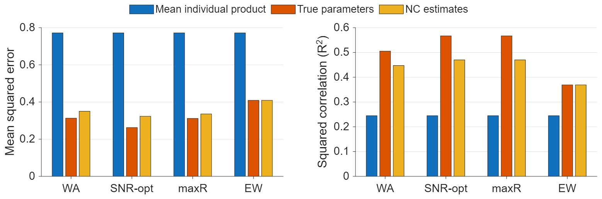
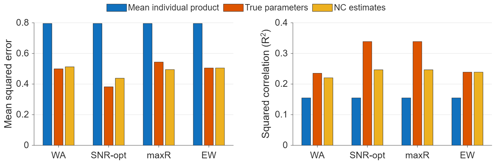
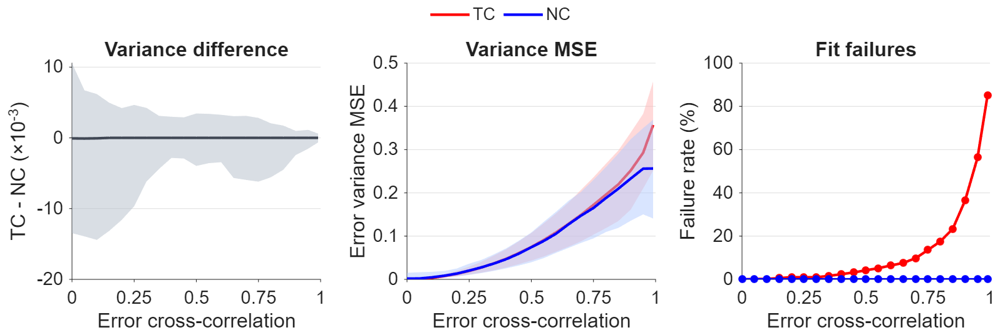

# SNR-opt with N-tuple collocation

SNR-opt merges collocated observations by minimizing the mean squared error of a linear estimate of a common signal. This repository includes MATLAB scripts and a Python notebook for SNR-opt, weighted averaging (WA), correlation maximization (maxR), and equal weighting (EW).

The current workflow uses the published N-tuple collocation (NC) estimator for error covariance and SNR estimation. The MATLAB implementation is based on [NC-public at `be461e3`](https://github.com/steelpl/NC-public/tree/be461e390045f09416e398049ae7c8d21db7230d). The Python helper implements the same default fitting and feasibility steps.

## Covariance model and weights

For centered, collocated products, the model is `x = a*y + e`, with the signal and errors uncorrelated. Let `Ey2 = Var(y)`, `theta = a*sqrt(Ey2)`, and `Q = Cov(x)`.

$$
Q = \theta\theta^{\mathsf T} + E, \qquad E = \mathrm{Cov}(e).
$$

NC minimizes the sum of absolute off-diagonal residuals under the bounds `theta(i)^2 <= Q(i,i)`. It then adjusts the fitted signal vector, if needed, so the residual error covariance is positive semidefinite (PSD) within numerical tolerance. Its diagnostics record any input covariance repair and change in fit from this second step. NC can be computed for two products, but that case is structurally underdetermined. Use three or more when available. In the presence of correlated errors, the physical signal and error covariances are generally non-unique.

SNR-est uses that one fit to compute the following quantities.

- `N = E/Ey2` is the error covariance normalized by target variance. It retains cross-product error covariance.
- `a = theta/sqrt(Ey2)` is the loading vector on the chosen target scale.
- `snr(i) = theta(i)^2/E(i,i)` is the product SNR as a linear ratio. For positive total and error variances, it also equals `rho2(i)/(1-rho2(i))`. Positive signal variance with zero error variance gives `Inf`. A constant product has undefined SNR and squared correlation.
- `fit` contains `errorCov`, `theta`, `rho2`, `covariance`, and `info`. Use `fit.covariance` for weights if NC repaired the input covariance.

SNR-opt solves `(N + a*a')*u = a` for linear minimum-MSE weights under the fitted model. maxR uses the same weight direction, with sum-to-one normalization when the sum is numerically safe. The pseudoinverse yields minimum-norm weights for singular observation covariance. WA uses the full error covariance to minimize error variance subject to weights summing to one, including singular cases. The WA interpretation assumes products are on a common scale. For an NC residual, pass the observation covariance scale as the second argument to WA, as in `WA(fit.errorCov,fit.info.covarianceScale)`. This sets the roundoff tolerance when the estimated errors are close to zero.

Supply a positive target variance to recover the intended target amplitude. Omitting it uses `Ey2 = 1` for a unit-variance latent target. NC determines the loading vector up to sign. SNR-est orients the loading with the largest magnitude positive. Use a known direction to align the merged series when the application requires it. A physical mean or scale requires external information.

## Run the examples

### MATLAB

From the repository root, add `MATLAB scripts` to the MATLAB path and run the scripts below. [MATLAB usage](MATLAB%20scripts/README.md)

```matlab
addpath('MATLAB scripts')
mergingExample_the  % Five products, known covariance
mergingExample_syn  % Three products, 100 synthetic time steps
TCvsNC              % TC and NC error cross-correlation sweep
```

In MATLAB R2025a or later, run `exportReadmeFigures` after adding `MATLAB scripts` to the path to regenerate the three README PNGs in `figures/`.

To merge your own data, let `X` be a numeric matrix with aligned time steps in rows and products in columns. Use a common set of valid observations to estimate the covariance. Retain at least two rows after filtering and use enough observations to estimate the covariance reliably.

```matlab
X = X(all(isfinite(X),2),:);
Xc = X - mean(X,1);
Q = cov(Xc);
[N, a, snr, fit] = SNRest(Q);      % Or SNRest(Q, targetVariance)
u = SNRopt(N,a);
merged = Xc*u;                     % Centered estimate on the chosen target scale
```

### Python and Jupyter

From the repository root, run the commands below, open `SNRopt_modular.ipynb`, and select **Run All**. The notebook prints the SNRs and metrics and displays the two-panel figure. [Python usage](Jupyter%20Notebook/README.md)

```bash
cd "Jupyter Notebook"
python -m pip install numpy matplotlib notebook
python -m notebook SNRopt_modular.ipynb
```

```python
from snropt_helpers import snr_est, snr_opt

N, a, snr, fit = snr_est(Q, return_fit=True)
u = snr_opt(N, a)
merged = Xc @ u
```

### Existing code

- Replace historical `ECVest(Q)` calls with `NC(Q)`. The first three outputs remain error covariance, latent loadings, and squared correlations. In Python, use `nc(Q)`.
- Existing `[N,a] = SNRest(Q,Ey2)` and `N, a = snr_est(Q, Ey2)` calls still work. Request the extra outputs when you also need error covariance, per-product SNR, or diagnostics. The covariance and loading estimates now come from the published NC implementation.
- `TC(Q)` remains available as a three-product baseline. Its third output uses each product's observed variance to compute squared correlation.

## Reproduced results

The default examples use seed 123 and error cross-correlation 0.30. For estimated weights, the simulated examples use half the true signal variance as a deliberately rough target-scale proxy. MSE and squared correlation are evaluated against the simulated signal. These are synthetic demonstrations.

### MATLAB merging examples



*Five-product covariance example generated by `mergingExample_the.m`.*



*Three-product time-series example with 100 simulated observations, generated by `mergingExample_syn.m`.*

The method order below is **WA, SNR-opt, maxR, EW**. Values are rounded to six decimal places.

```text
Example                          Parameters    MSE                                  Squared correlation
MATLAB, covariance (5 products)  True          0.312919  0.262512  0.311543  0.409061  0.505142  0.566917  0.566917  0.368939
MATLAB, covariance (5 products)  NC            0.350290  0.323174  0.335731  0.409061  0.447181  0.469859  0.469859  0.368939
MATLAB, time series (3 products) True          0.499367  0.382047  0.543721  0.504999  0.235275  0.338769  0.338769  0.238900
MATLAB, time series (3 products) NC            0.512495  0.438131  0.494576  0.504999  0.220389  0.246589  0.246589  0.238900
Python, time series (3 products) True          0.499367  0.382047  0.543721  0.504999  0.235275  0.338769  0.338769  0.238900
Python, time series (3 products) NC            0.512495  0.438131  0.494576  0.504999  0.220389  0.246589  0.246589  0.238900
```

The MATLAB covariance example returned NC linear SNRs of approximately `[1.174, 0.3282, 0.3136, 1.161, 1.197]`. The MATLAB time-series example returned `[0.7394, 0.5178, 0.5346]`. Their minimum error covariance eigenvalues were 0.2850 and 0.2951, respectively. The notebook reproduced the three-product SNRs and minimum eigenvalue at the displayed precision.

### TC–NC comparison

The TC–NC sweep uses 500 draws at each of 21 error-correlation levels. NC passed the finite, diagonal, and PSD checks in all 10,500 fits. TC failures rose from 0% at zero error correlation to 85% at 0.99. Median variance MSE is computed separately over the valid fits of each method.



*The lines in the first two panels show medians and the shaded bands show interquartile ranges. The variance differences use draws with valid fits from both methods. Figure generated by `TCvsNC.m`.*

<details>
<summary>Full TC–NC sweep results</summary>

```text
Error correlation   TC fail (%)   NC fail (%)   TC median variance MSE   NC median variance MSE
0.00                  0.0           0.0           4.1087e-33               0.0018004
0.05                  0.2           0.0           0.00098045               0.0020556
0.10                  0.2           0.0           0.0035683                0.0047663
0.15                  0.6           0.0           0.0073962                0.0084245
0.20                  1.0           0.0           0.012640                 0.013388
0.25                  1.0           0.0           0.019365                 0.020339
0.30                  1.0           0.0           0.027475                 0.027915
0.35                  1.6           0.0           0.037172                 0.036712
0.40                  2.4           0.0           0.047979                 0.046857
0.45                  3.2           0.0           0.060940                 0.059524
0.50                  4.2           0.0           0.074976                 0.074288
0.55                  5.2           0.0           0.091071                 0.088817
0.60                  6.4           0.0           0.10878                  0.10579
0.65                  7.6           0.0           0.12853                  0.12737
0.70                  9.8           0.0           0.14928                  0.14733
0.75                 13.6           0.0           0.17222                  0.16510
0.80                 17.6           0.0           0.19583                  0.18803
0.85                 23.4           0.0           0.21961                  0.20967
0.90                 36.6           0.0           0.25179                  0.23311
0.95                 56.4           0.0           0.29288                  0.25601
0.99                 85.0           0.0           0.35677                  0.25635
```

</details>

Verified in MATLAB R2025b and Python 3.13. The three MATLAB scripts generated their figures, and the notebook completed with an inline figure. Across six shared covariance cases, including mixed-sign loadings, singular matrices, a constant product, and a repaired input, the largest absolute MATLAB–Python differences were 1.77e-14 for error covariance and 5.77e-15 for merging weights. The checks also covered changes in covariance units and the invariance of product SNR to the chosen target variance.

## References

- Kim, S., Sharma, A., Liu, Y. Y., & Young, S. I. (2022). Rethinking satellite data merging: From averaging to SNR optimization. *IEEE Transactions on Geoscience and Remote Sensing*, 60, 1–15. [DOI](https://doi.org/10.1109/TGRS.2021.3107028)
- Pham, H. T., & Kim, S. (2027). N-tuple collocation for reference-free uncertainty estimation from multi-source hydrological data: Beyond triple collocation and three-cornered hat. *Journal of Hydrology*, 682, 136749. Published online in 2026 and assigned to the January 2027 volume. [DOI](https://doi.org/10.1016/j.jhydrol.2026.136749)

## Author and license

Seokhyeon Kim, on behalf of the coauthors, Kyung Hee University. [Water Resources and Environment Big Data Lab](https://sites.google.com/view/wrebigdl/)

[MIT License](LICENSE)
